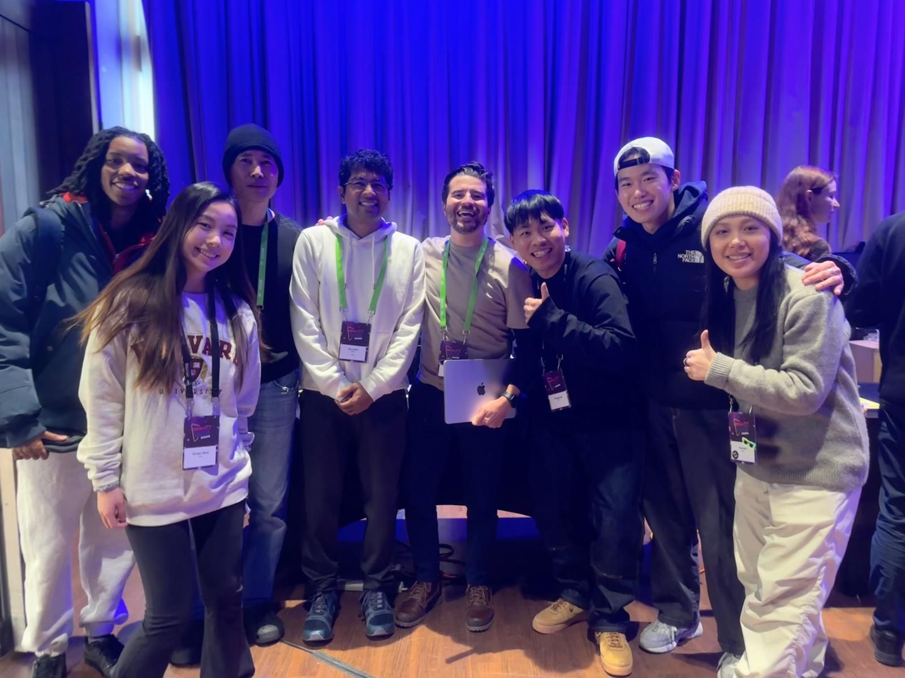
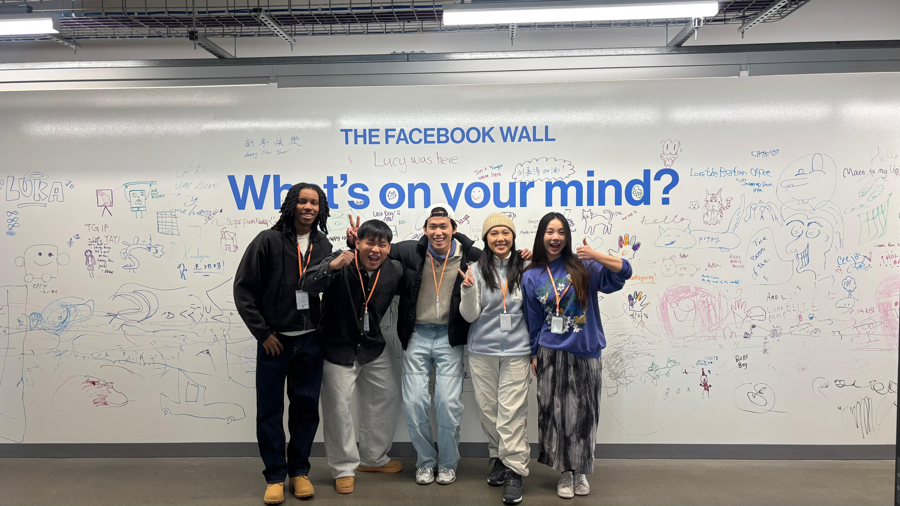
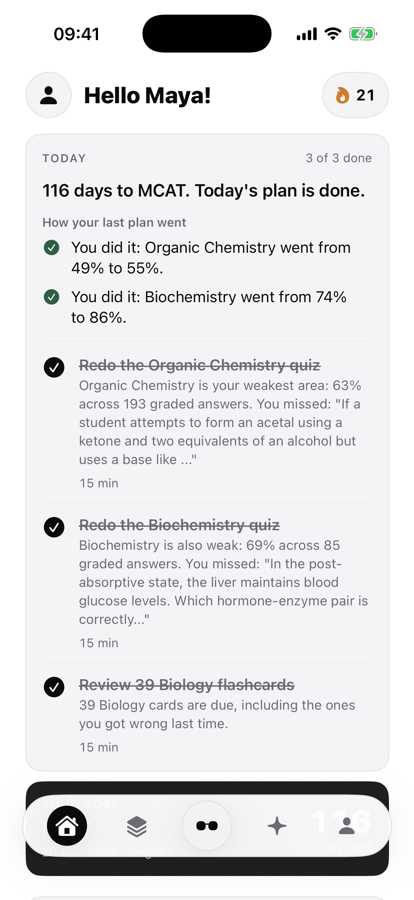
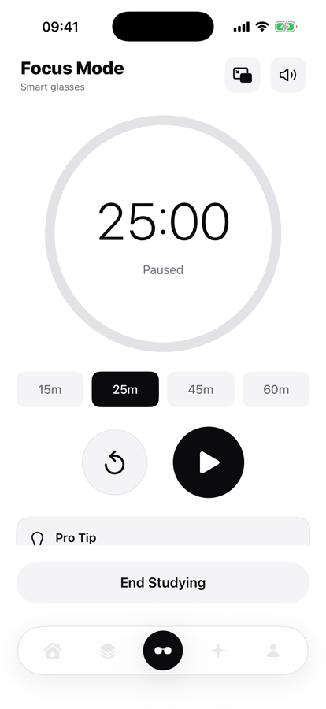
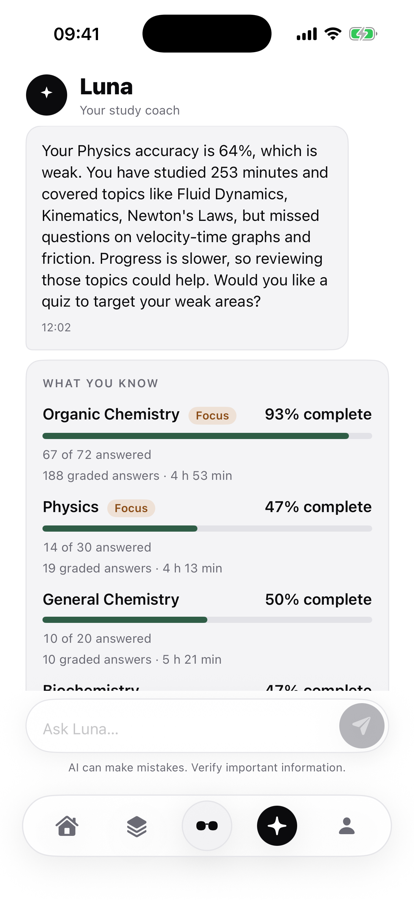
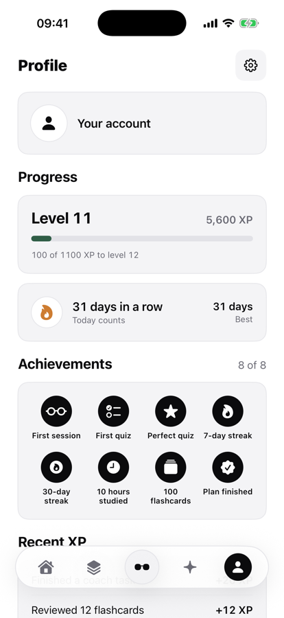

  <h1>SmartSight: You Study. We Coach.</h1>

  

  
<b>An AI study coach for MCAT students. Study with your iPhone camera or Ray-Ban Meta glasses; SmartSight notes what you study and coaches you on what to do next.</b>

  

    <a href="https://getsmartsight.com">🌐 getsmartsight.com</a>
    &nbsp;|&nbsp;
    <a href="https://youtu.be/PbS7iEWzLyw?si=vtYj21MkKTWro6t1">📺 Demo video</a>
    &nbsp;|&nbsp;
    📱 iOS: TestFlight beta (public link coming soon)
  

> **Status, November 2026:** the iOS app is in TestFlight as **SmartSight: Study Coach**, with a public beta in Apple review. The backend runs on Render and Supabase.

---

## Achievements

- **MIT Reality Hack 2026: Grand Prize (Gold Award)**
- **MIT Reality Hack 2026: Meta Track winner**
- **Selected for AWE USA 2026**, the world's largest XR + AI event

  

---

## The problem

Studying for a big exam like the MCAT means months of self-study, and most students can't tell what they've actually covered.

- **Logging breaks focus.** Timers, subject pickers and study journals interrupt the work they're meant to measure.
- **Hours aren't knowledge.** "4 hours today" says nothing about which topics you covered or which ones are slipping.
- **No feedback loop.** Practice questions and flashcards are made by hand, if at all, and rarely match what you just read.

## What SmartSight does

SmartSight sits beside you while you study and turns the pages you read into a study log, a plan and practice material, without you typing anything.

| | |
|---|---|
| **Hands-free study log** | Point your phone camera or wear Ray-Ban Meta glasses. Every few seconds the phone reads the page and SmartSight works out the MCAT subject and topic, so time per topic is logged automatically. |
| **Private by design** | Text recognition runs on the phone. Only the words on the page go to the server, and **photos never leave your device**. |
| **A daily plan** | Each day the coach picks 1–3 tasks: catch up on a stalled subject, redo a weak quiz, clear due flashcards. It's based on your curriculum coverage, your pace toward exam day and your own results. |
| **Quizzes and flashcards from your own pages** | Generated from what you actually read in each session, not a generic question bank. |
| **Luna, a voice coach** | Say "Hey Luna" to ask about the page in front of you without looking up. She knows what you're reading, explains concepts, quizzes you out loud and can bookmark a page for you. |
| **Luna chat with live cards** | Ask "Am I on track?" and get your MCAT coverage per subject, weekly stats, a quiz to answer in place or flashcards to flip. |
| **Progress you can see** | Levels, XP, streaks and achievements, plus a Vault of every topic you've studied with mastery and cards due. |

  
  
  
  

## How it evolved

SmartSight started at MIT Reality Hack in January 2026 as a glasses app that judged every photo for focus and distraction. In May 2026 it became a **study-content logger**. The phone now reads the page itself and sends only text, so it's more private, cheaper and faster, and quizzes, flashcards and the coach only ever needed the text. Since then:

- Luna moved to a direct Gemini Live voice connection.
- The app got a monochrome redesign.
- The backend moved from AWS to Render and Supabase.
- Home, Vault and Profile switched to real data, with a coverage-aware daily coach.

Meta doesn't allow apps built on its glasses SDK on the App Store yet. Until it does, public builds use the iPhone camera and the glasses work in internal builds.

---

## Tech stack

| Area | Technology |
|---|---|
| **iOS app** | Swift 6, SwiftUI, Apple Vision (on-device OCR), Speech ("Hey Luna" wake word), Meta Wearables Device Access Toolkit |
| **Voice** | Gemini Live, a direct device-to-Google WebSocket with server-minted, single-use tokens |
| **AI** | Gemini 3.5 Flash (topic classification), Gemini 3 Flash → 3.1 Pro escalation ladder (quizzes, flashcards), GPT-4.1 (coach chat) |
| **Backend** | Node.js 20, Express, Prisma, PostgreSQL |
| **Infrastructure** | Render, Supabase (Postgres + Storage) |
| **Hardware** | iPhone; Ray-Ban Meta smart glasses |

---

## Team

| Name | Role |
|---|---|
| [Hyunseok Hwang](https://www.linkedin.com/in/hyunseok-hwang/) | Product Engineer |
| [Sylvan (Xiaofan) Shen](https://www.linkedin.com/in/xiaofan-sylvan-shen/) | Product Manager & Glasses UX Designer |
| [Vivian Xin Shu](https://www.linkedin.com/in/vivian-xin-shu/) | Product Manager & Designer |
| [Jayden DeCambre](https://www.linkedin.com/in/jaydendecambre/) | iOS Engineer |
| [Dongchan Kim](https://www.linkedin.com/in/dongckim99/) | Backend Engineer |

---

## Links

- [Website: getsmartsight.com](https://getsmartsight.com) ([source](https://github.com/SmartSightStartup/smartsight-website))
- [Pitch deck](https://www.canva.com/design/DAG_XQDLTDo/Ve8QZl2jKriKnRknXeBuMg/view?utm_content=DAG_XQDLTDo&utm_campaign=designshare&utm_medium=link2&utm_source=uniquelinks&utlId=h1b6bd5e0de)
- [Demo video](https://youtu.be/PbS7iEWzLyw?si=vtYj21MkKTWro6t1)
